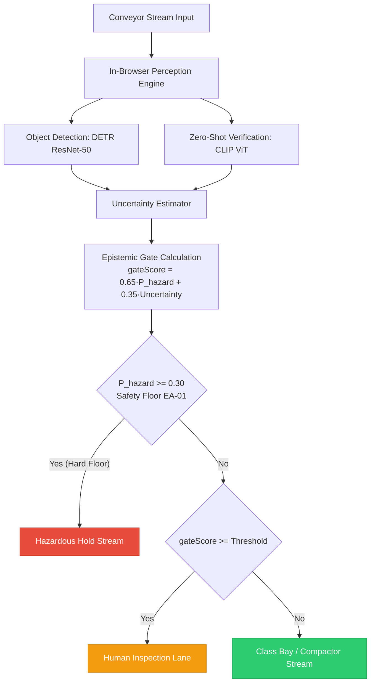
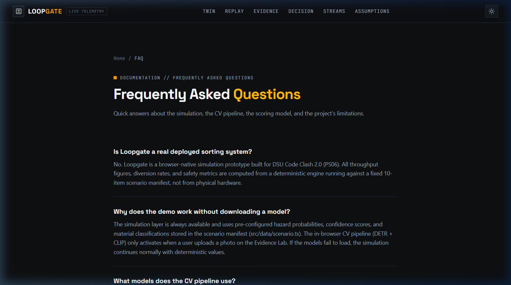
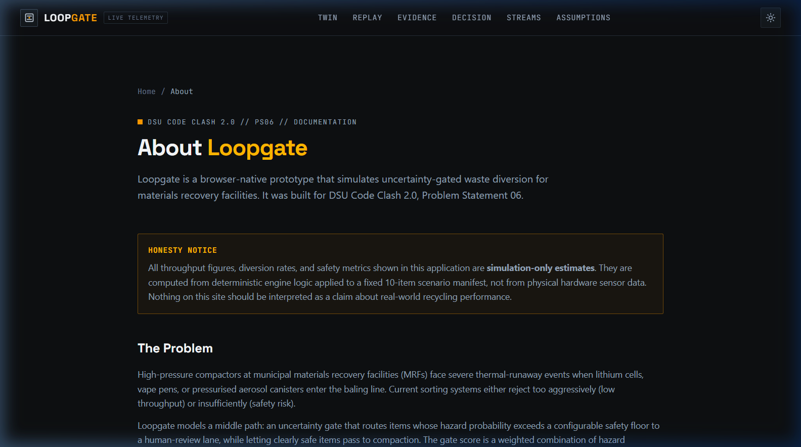
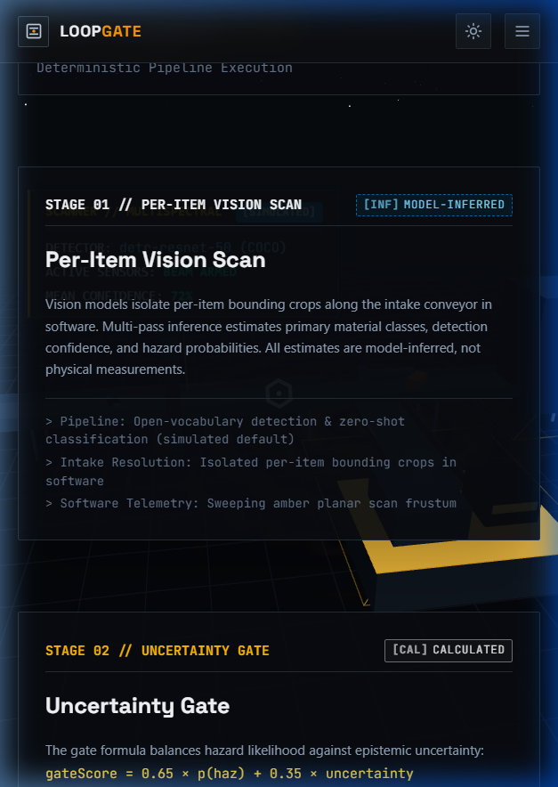

# Loopgate

> **Uncertainty-Gated Waste Routing (Simulated Digital Twin)**  
> Problem Statement 06 // DSU Code Clash 2.0  
> **Live Demo:** [https://loopgate-rose.vercel.app](https://loopgate-rose.vercel.app)  
> **Team:** NEXARC | **Repository:** [selfabhijeetkumar/loopgate](https://github.com/selfabhijeetkumar/loopgate)

Loopgate is an epistemic uncertainty router and 3D digital twin that identifies and intercepts hazardous waste items (lithium-ion batteries, vape pens, aerosol canisters) before they reach automated municipal baling compactors.

---

## Architecture



---

## Live Screenshots

| 01. Hero & Digital Twin | 02. Scan & Gate Split View |
|:---:|:---:|
|  |  |

| 03. Interactive 3D Twin | 04. Replay Theatre |
|:---:|:---:|
|  |  |

| 05. Evidence Lab Real CV | 06. GenAI Explanation Engine |
|:---:|:---:|
|  |  |

| 07. FAQ & Auditing | 08. About & Team NEXARC |
|:---:|:---:|
|  |  |

| 09. Mobile View (375px) | 10. Mobile 3D Canvas Responsive |
|:---:|:---:|
|  |  |

---

## Key Capabilities

1. **In-Browser Vision Perception**:
   - Zero-shot classification and open-vocabulary detection in software.
   - Fallback chain: DETR ResNet-50 + zero-shot CLIP classification + verified bounding crops.
   - Strict provenance discipline: every metric and label is explicitly marked (`Calculated`, `Simulated`, `Model-inferred`).

2. **Deterministic Uncertainty Engine**:
   - Closed-form gate score calculation:
     $$\text{gateScore} = 0.65 \times p(\text{hazard}) + 0.35 \times \text{uncertainty}$$
   - **Invariant EA-01**: Hard safety floor at $p(\text{hazard}) \ge 0.30$. Any item meeting or exceeding this threshold is strictly barred from the compactor stream under all operator configurations.

3. **Full-Viewport 3D Facility Digital Twin**:
   - Interactive line visualization built with React Three Fiber and Three.js.
   - Critically damped spring camera smoothing ($\omega = 7.2\,\text{rad/s}$, zero overshoot, frame-rate independent).
   - Seeded procedural deep-space backdrop with 3 parallax layers and twinkle animation.
   - Dynamic floor ripple shader with horizon fade into industrial background `#070a0d`.
   - Quality tiers (`HIGH`, `MEDIUM`, `LOW`) with dynamic performance downgrade and `prefers-reduced-motion` compliance.

---

## Getting Started & Reproduction Steps

### Prerequisites
- Node.js 18+ (tested on Node 20+)
- npm or pnpm

### Installation
```bash
git clone https://github.com/selfabhijeetkumar/loopgate.git
cd loopgate
npm install
```

### Development Server
```bash
npm run dev
# Visit http://localhost:3000
```

### Verification & Testing
```bash
# Typecheck
npm run typecheck

# Lint
npm run lint

# Unit and integration tests (Vitest - 114 passing tests)
npm test

# Production build
npm run build
```

---

## License
Private repository for DSU Code Clash 2.0 evaluation.

